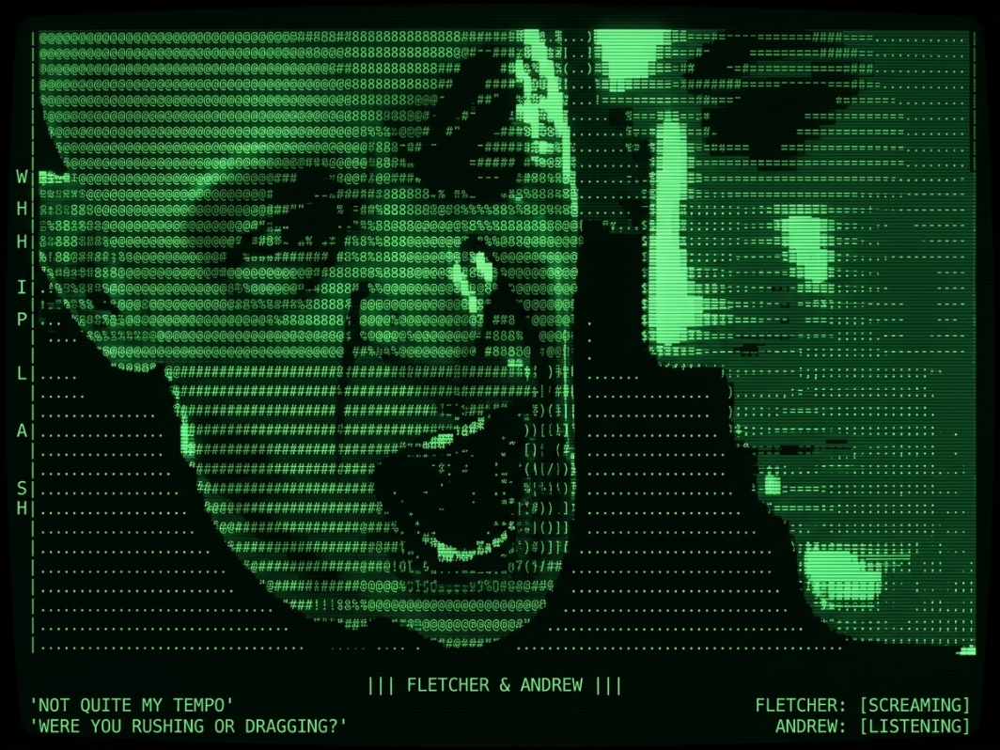
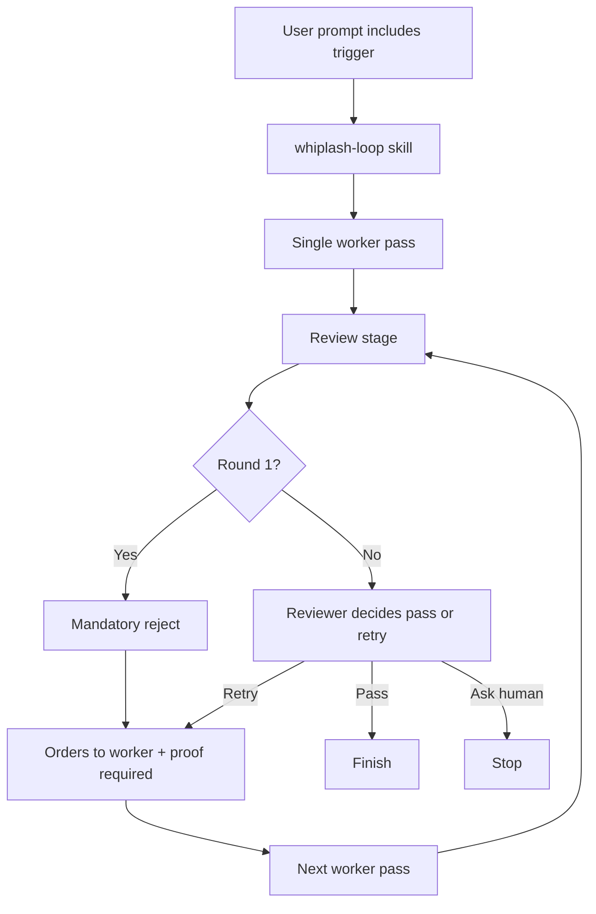
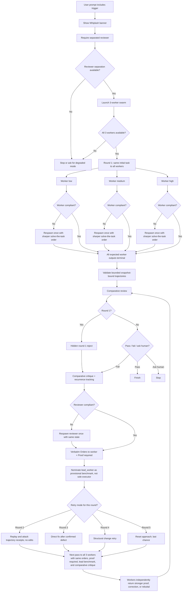

# Whiplash Loop



`whiplash-loop` is a Codex skill for Fletcher-style, proof-first retry orchestration triggered by `위플래쉬` or `플레처소환`.

## 설계 의도와 기대 효과

### 무엇을 하려는가

이 구조의 본질은 여러 에이전트에게 일을 나눠 주는 것이 아닙니다. 같은 문제를 서로 다른 모델과 추론 강도로 독립적으로 풀게 한 뒤, 결과를 의도적으로 충돌시켜 단일 에이전트의 자기확증 편향을 깨는 것이 목적입니다.

### 어떻게 작동하는가

```text
동일한 문제
├─ low: 빠르고 작은 해법
├─ medium: 균형 잡힌 해법
└─ high: 깊고 구조적인 해법
        ↓
독립 결과 비교
        ↓
일치보다 불일치에 집중
        ↓
각 주장에 증거 요구
        ↓
snapshot-bound evidence trajectory 생성
        ↓
Round 2에서 receipt 재현·반박·증거 확장
```

Round 1의 mandatory reject는 첫 구현이 반드시 틀렸다는 뜻이 아닙니다. 세 결과 중 하나를 너무 빨리 정답으로 채택하지 않고, 충돌을 한 번 더 증폭시켜 숨은 전제와 편향을 드러내기 위한 장치입니다.

Round 2에서는 파일을 수정하지 않습니다. 세 worker가 lead 결과를 재현하고, 실패 경로와 회귀 증거를 확장하고, 서로의 결론을 반박합니다. 실제 결함이 확인된 경우에만 Round 3부터 수정을 시작합니다.

각 worker pass는 최종 mutation 이후의 snapshot, 실행한 검증, 그 검증이 적용된 snapshot, 주장과 증거 공백을 bounded evidence trajectory로 남깁니다. 이 trajectory는 정답이나 전체 대화 기록이 아니라 Round 2가 재현하고 공격할 claim index입니다. 모든 trajectory가 완전해도 Round 1은 반드시 hidden reject됩니다. trajectory는 자기편향 충돌을 대체하지 않고, 그 충돌이 실제 실행 증거를 향하도록 만듭니다.

### 왜 효과적인가

다음 조건이 지켜질 때 단일 에이전트보다 강한 검증 효과를 기대할 수 있습니다.

- 서로의 답을 보기 전에 독립적으로 작업한다.
- 모두 같은 문제를 직접 해결한다.
- reviewer는 다수결보다 불일치를 분석한다.
- `lead_worker`를 정답이 아니라 반박하고 검증할 기준점으로 사용한다.
- 주장보다 테스트, 실패 경로, 실행 결과를 우선한다.

단일 에이전트는 자신이 만든 코드와 설명을 재검토할 때 같은 전제를 반복하기 쉽습니다. 다른 모델과 추론 강도를 충돌시키면 서로 다른 휴리스틱과 실패 지점이 드러날 가능성이 커집니다.

### 어떤 한계가 있는가

- 같은 시스템 지시와 reviewer 프레이밍으로 상관 편향이 생길 수 있다.
- reviewer가 가장 자신감 있는 답에 앵커링할 수 있다.
- shared workspace 변경이 후발 worker의 독립성을 훼손할 수 있다.
- mandatory reject가 실질적 반증 없이 형식적 재시도가 될 수 있다.
- worker와 reviewer가 같은 모델 계열이면 실제 다양성이 작을 수 있다.

따라서 이 구조의 핵심 평가 기준은 에이전트 수 자체가 아닙니다.

```text
독립성 × 모델 다양성 × 불일치 추출 × 증거 기반 판정
```

## What It Does

- shows the PR2-style Whiplash ASCII banner at activation time
- uses `whiplash-reviewer` as a separated Fletcher orchestrator
- hides the round-1 mandatory reject from workers
- runs a default 3-worker swarm (`low`, `medium`, `high`)
- gives the same initial task to all three workers in round 1
- waits for all expected worker outputs before invoking the reviewer
- records a bounded snapshot-bound evidence trajectory for every worker pass
- compares worker outputs before retrying
- uses round 2 to replay and attack Round-1 trajectory receipts without file edits
- treats `lead_worker` as a provisional benchmark, not a sole next executor
- sends fail-round retry orders back to all three workers by default, using the lead benchmark to pressure stronger proof, corrections, or rebuttals
- allows role-split retries only after the first comparative review, while preserving three-worker adversarial comparison unless explicitly degraded
- pushes short, forceful English worker orders with proof requirements
- stops instead of silently degrading when full reviewer separation or full 3-worker fan-out is unavailable
- retries noncompliant workers or reviewers once before accepting malformed loop behavior
- waits at least 10 minutes for high-reasoning Whiplash agents before treating them as stalled
- does not treat a plain `wait_agent` timeout as worker failure
- uses non-git verification evidence when the task runs outside a Git repository
- starts repair only after round-2 revalidation confirms a defect, then rotates repair strategy
- tracks recurrence plus a prevention note for defect classes that keep returning
- exposes `premature_review` and `round_consumed=false` so wrappers do not advance rounds on incomplete worker sets
- supports structured verdict data for internal loop control

## Main Files

- `.codex/skills/whiplash-loop/SKILL.md`
- `.codex/skills/whiplash-loop/agents/openai.yaml`
- `.codex/skills/whiplash-loop/references/whiplash-reviewer-profile.md`
- `.codex/skills/whiplash-loop/references/whiplash-evidence-trajectory.md`
- `.codex/skills/whiplash-loop/references/whiplash-reviewer-verdict.schema.json`
- `.codex/agents/whiplash-reviewer.toml`
- `.codex/agents/whiplash-worker-low.toml`
- `.codex/agents/whiplash-worker-medium.toml`
- `.codex/agents/whiplash-worker-high.toml`
- `.codex/agents/whiplash-reviewer-verdict.schema.json`

## Legacy Flow

This was the earlier reviewer-led loop before the orchestrated v2 redesign.



## Current Flow

This is the current Whiplash v2 design.



## Runtime Notes

- Activation currently includes the PR2-style banner before the loop begins.
- Full Whiplash v2 requires reviewer separation and the full 3-worker swarm. If either is unavailable, the loop should stop and ask for degraded mode instead of silently collapsing.
- Round 1 is always the same task to all workers. Early topic split is not part of the design.
- Every worker pass returns a bounded trajectory with task/candidate identity, before/after snapshot references, ordered mutations and proof checks, claims, proof gaps, and trajectory status. Full transcripts and hidden reasoning are excluded.
- Trajectory completeness is procedural only. It never creates a Round-1 pass path or weakens the hidden mandatory reject.
- The reviewer must not be invoked while only a partial worker set has returned. A one-worker result is not enough to spend the hidden round-1 reject.
- After a fail verdict, the next pass still goes to all three workers by default. The lead worker is only the strongest provisional benchmark used to pressure the lead for more proof and the other workers for missed issues, disagreements, or stronger rebuttals.
- Worker or reviewer noncompliance is retried once before the loop accepts that failure mode as real.
- High-reasoning agents such as `whiplash-worker-high` and `whiplash-reviewer` should get at least a 10-minute `wait_agent` window before they are treated as stalled.
- A plain `wait_agent` timeout means "still waiting," not "worker failed."
- Machine-readable premature reviews should use `decision=premature_review`, `premature_review=true`, and `round_consumed=false`; wrappers must not advance the round counter or spend the hidden reject when `round_consumed=false`.
- On fail rounds, `Orders to worker` should be shown verbatim before any higher-level explanation.
- Active fail rounds should persist through `.codex/context/whiplash-state.json` so the next user turn resumes the same loop before any new top-level workflow starts.
- New execution requests that arrive during an active fail round should be queued into the next Whiplash round unless the user explicitly stops or replaces Whiplash.
- Outside Git repositories, verification should rely on file contents, hashes, byte checks, listings, or targeted command output rather than failing `git diff` as core evidence.
- Round 2 receives the same bounded Round-1 trajectory set, replays accessible receipts, exposes stale or non-reproducible proof, and expands evidence without edits. Its before/after snapshots must match. If it confirms a defect, repair starts in round 3 and rotates through direct fix, structural change, and reset approach.
- Evidence must cover build-or-equivalent output, changed behavior, at least one failure path, and no-regression confidence.
- Repeated defect classes should be surfaced through `recurrence` and `prevention_note`.

## Note On The Logo

This repository now uses the supplied reference image directly as the logo asset.
